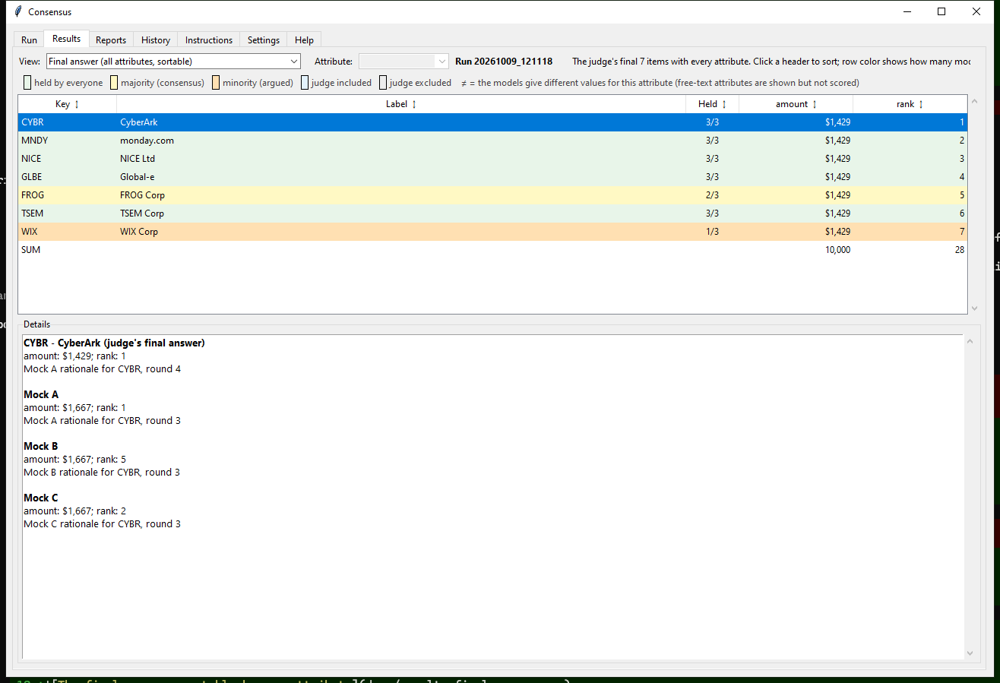
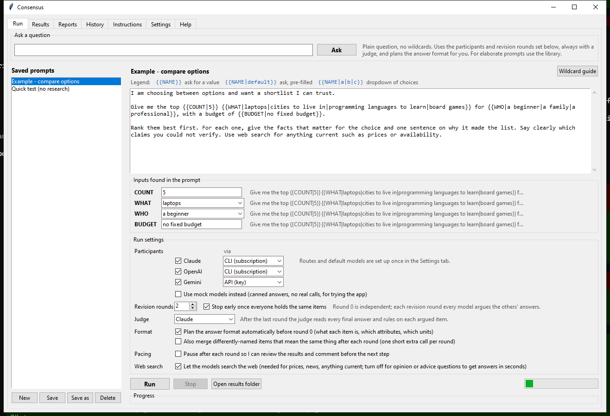
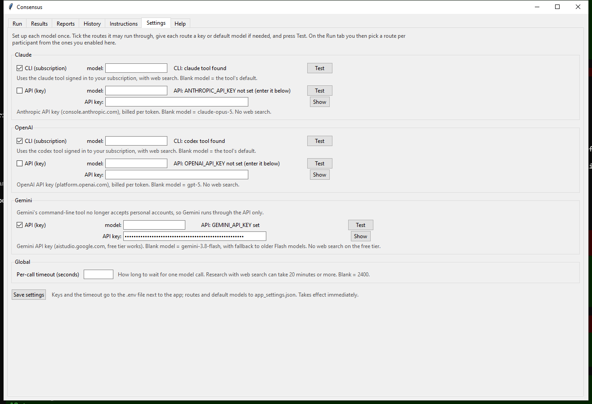

# Consensus

**Consensus** asks two or three AI models the same question, then makes them check each
other's work. Each model answers on its own first. In every revision round it reads the
others' answers, verifies their claims, and revises its own, under instructions not to
blindly follow and not to stubbornly ignore. At the end a judge reads every final answer and
rules on each disputed point. You get one ranked answer, a table showing which model held
which item at what value, and a plain-language story of the whole argument.

It's for questions where the answer is a shortlist and being wrong matters: which stocks to
buy, which cities to move to, which practices to learn. Two models with different training
and different search habits make different mistakes, and forcing them to argue surfaces
errors a single chat session never would.

It runs on the subscriptions you already have, through the official Claude and Codex
command-line tools, plus a free Gemini API key. It's a desktop app for your own machine:
nothing is hosted and no API credits are needed.

| Run tab | Settings tab |
|---|---|
|  |  |

New here? Read [GETTING_STARTED.md](./GETTING_STARTED.md), or the Help tab inside the app.
It walks through installing Python, Node.js, the Claude and Codex tools, and a Gemini key.

## Start the app

Double-click `Consensus.pyw`, or run `python consensus_app.py`.

## One-time setup for each participant

| Participant | Install | Sign in |
|---|---|---|
| Claude | `npm install -g @anthropic-ai/claude-code` | run `claude` once |
| Codex | `npm install -g @openai/codex` | run `codex` once, choose ChatGPT login |
| Gemini | nothing to install | put `GEMINI_API_KEY=...` in a `.env` file next to the app (free key at aistudio.google.com) |

Any two are enough. All three gives majority votes instead of ties.

Gemini runs through the Gemini API because Google stopped letting its command-line tool sign
in with personal accounts in June 2026. On the free API tier Gemini answers without web
search (search grounding is a paid feature), which the app notes in its "could not verify"
field, and if the newest Flash model is overloaded it falls back to an older one.

## Just ask

Type a plain question in the **Ask a question** box at the top of the Run tab and press
Enter. That runs the enabled participants with the revision rounds set below and a judge,
and first has a quick model write the answer template: what one item is, exactly how to
write its key (ticker in capitals, city name without country, full name), and for every
attribute its unit, exact written form with an example, and for text attributes a closed
list of allowed values. The template is appended to the prompt every model receives so
that two models meaning the same thing write it identically. It is saved as `plan.md` and
summarized in the progress log.

The same planning step is on by default for library prompts too (the **Format** checkbox in
Run settings). Turn it off when a prompt already spells out exactly what it wants. The
optional **merge** checkbox next to it adds one short call after each round that spots
items listed under different names and gives them one shared key.

## How a run works

1. Pick a saved prompt on the left, or write one and click **Save as**.
2. Fill in the inputs the prompt asks for (see Wildcards below).
3. Choose participants, revision rounds, and optionally a judge.
4. Click **Run**. Each finished round appears in the Results tab while the next one runs.
   **Stop** kills the running tools and keeps the rounds already finished.

Round 0: every model answers independently. Each revision round: every model sees the
others' latest answers and revises under the program instructions (verify, don't blindly
follow, don't stubbornly ignore, say where you still disagree and why). With *stop early*
on, revising ends as soon as everyone holds the same items. Judge pass: the chosen model
reads every final answer plus the agreement summary and rules on each argued item.

## Speed

A research round with web search takes 2 to 10 minutes per model, because each one searches,
reads, verifies and then writes a full report under a strict format; nothing is shown until
the whole answer is done. For opinion or advice questions, untick **Web search** in Run
settings (or pass `--no-search` on the command line): the models answer from memory in
seconds. Gemini on the free API tier never searches regardless.

## Steering a run between rounds

Under the progress log is a note box. Anything you type there is sent to every model with
the next step, labeled as coming from you and outranking the models' own opinions, and it
stays in force for all later rounds and the judge. Tick **Pause after each round** in Run
settings and the run stops after every round so you can read the results first, then press
Continue, Skip to judge, or Stop here. Your notes are saved as `notes.md` in the run folder
and shown in the Details pane for the round they preceded.

## Reading the results

- **Results tab**: one row per item, one column per model. Green rows are held by everyone,
  yellow by a majority (consensus), orange by a minority (argued). Items match on their key
  or label after folding case, accents and punctuation. Numbers are compared exactly: a
  `≠` in a cell means the models give different numbers for that attribute, and the summary
  line counts how many agreed items still have differing numbers and whether the ranking
  order matches. Text attributes are shown but not scored. The view selector steps through
  rounds and the judge's ruling. Click a row for each model's rationale.
- **Full consensus** (which triggers *stop early*) means every model holds the same items
  with identical numbers and the same order.
- **Single-answer questions** (the planner decides this) show the judge's written answer
  first; the rows are the claims each model relied on.
- **Reports tab**: `story.md` first, a plain-language narrative of the run built from the
  data (what each model listed, what it added, dropped or re-ranked each round and why in its
  own words, the judge's rulings, the final ranking). Then every model's full written answer
  for every round, the judge's report, and `consolidated.md` with the matrix, consensus and
  argued lists, rulings and change notes.
- **Sorting**: click any column header in the Results table to sort by it; click again to
  reverse. Numbers sort as numbers, blanks stay at the bottom.
- **Final answer view**: the last entry in the View dropdown shows the judge's final list with
  one column per attribute (rank, price, elevation, ...), so you can sort by any of them and
  still see the judge's rank. Row color shows how many models held each item.
- **History tab**: every past run, loadable.
- **Instructions tab**: the program instructions sent to the models. Edit them to change
  how the models argue or how the judge rules.
- **Settings tab**: per-model setup (see Models and routes above) plus the per-call timeout.
  Keys and the timeout go to the `.env` file next to the app, so the command line uses the
  same values; routes and default models go to `app_settings.json`.

Everything is saved under `results/<timestamp>/`, including `final_table.csv`.

## Wildcards

Write these anywhere in a prompt:

| Syntax | Effect |
|---|---|
| `{{AMOUNT}}` | input box, required |
| `{{HORIZON\|10 years}}` | input box pre-filled with a default |
| `{{RISK\|low\|medium\|high}}` | dropdown, first choice is the default, typing allowed |

The same name used twice is asked once. Values are remembered between runs. Today's date
is always added to the top of the prompt.

## Models and routes

The **Settings tab** has one card per model (Claude, OpenAI, Gemini). On each card you tick
the routes that model may run through, give each route a default model name if you want one
other than the tool's or API's default, enter the API key for the API route, and press Test
to make one tiny call.

- **CLI (subscription)**: the vendor's command-line tool signed in to your account, with web
  search. Claude and OpenAI (through Codex).
- **API (key)**: the vendor's API with a key, billed per token (Gemini has a free tier). No
  web search. All three; Gemini is API only.

On the **Run tab** each participant offers only the routes enabled in Settings; a model with
no route enabled is greyed out. Mixing is fine and is the default: Claude and OpenAI on
subscriptions, Gemini on a free API key. The **mock** checkbox replaces every participant
with canned answers for trying the app without any real calls.

## Command line

    python consensus_cli.py --prompt "Example - compare options" --rounds 2 --judge claude
    python consensus_cli.py --prompt-file p.txt --participants claude,codex,gemini --input AMOUNT=10000
    python consensus_cli.py --ask "best 5 board games for families" --via codex=api --model codex=gpt-5
    python consensus_cli.py --prompt "Quick test (no research)" --mock --participants claude,codex,gemini

## Standalone exe

    pip install pyinstaller
    build_exe.bat
